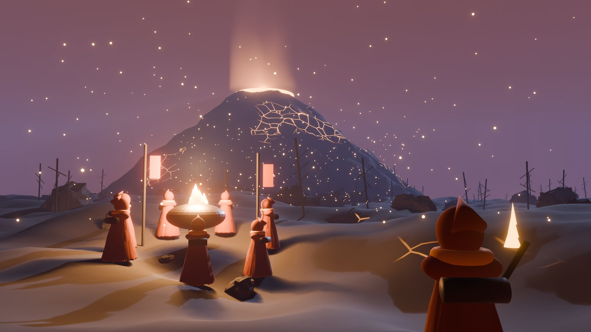

# HALF-LIGHT

**A tribe survival game on XEN's clock, and the NXN protocol that keeps DBXen burning after AMP reaches 1.**



XEN's amplifier falls by one every day and reaches 1 around 24 December 2030. After that, new XEN almost stops arriving and DBXen's burns depend on XEN that already exists. This project proposes two things:

- **The Granary and NXN**, a contract that stores XEN now and burns it into DBXen after the floor, with NXN as the closure token of the XEN → DBXen → NXD stack.
- **HALF-LIGHT**, a slow strategy game for tribes on a cooling world, where every warm hex, rescue and sponsor crate is a real mint, burn, stake or deposit.

> **Status: open design.** Everything here is a draft for the community to challenge. Nothing is deployed. Nothing here is financial advice.

## Read the book

Start at [`docs/README.md`](docs/README.md), or read it on GitBook once the repository is connected.

| Section | What's inside |
| --- | --- |
| [The winter problem](docs/the-winter-problem.md) | Why the stack needs a closure |
| [The protocols](docs/protocols/README.md) | XEN, DBXen and NXD rules, verified in source |
| [The NXN protocol](docs/granary/README.md) | Deposits, emission, storage, release, launch gates |
| [The game](docs/game/README.md) | Tribes, days and seasons, the map, the Reaping, NXN in game |
| [The model](docs/model/README.md) | Equations and coefficients to fit |
| [Simulations](docs/model/simulations.md) | Monte Carlo results and limits |
| [Open questions](docs/open-questions.md) | What is still to decide |

## Repository layout

```
docs/          the book (GitBook), with diagrams and art in docs/assets/
sim/           Monte Carlo model of XEN, DBXen and the Granary (Python)
sim/game/      the season simulator (open the HTML file in a browser)
tools/         scripts that generate the diagrams
.github/       issue and pull request templates
```

## Contributing

Proposals, simulation results and questions are welcome as issues. See [CONTRIBUTING.md](CONTRIBUTING.md).

## License

Code under [MIT](LICENSE). Docs and art under [CC BY 4.0](LICENSE-docs.md).
