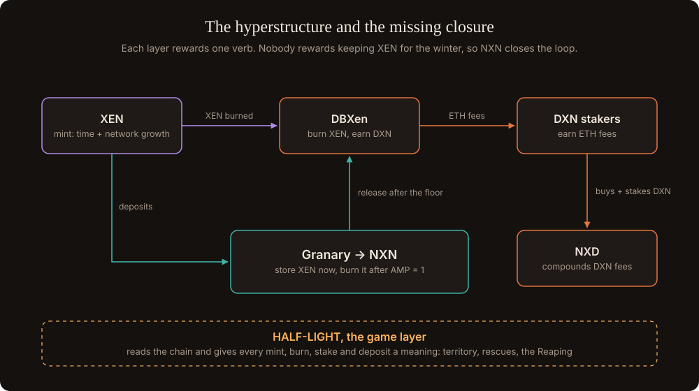

# HALF-LIGHT

**A tribe survival game on XEN's clock, and the NXN protocol that keeps DBXen burning after AMP reaches 1.**

The sun of this world is XEN's AMP. It cools by one degree every day, from 3,000 at genesis to 1 around **24 December 2030**. Tribes keep territory alive only while they keep it warm, and every warm hex, sponsor crate and rescue is a real protocol action: a mint, a burn, a stake or a deposit.

Under the game sits the **Granary**, a contract that stores XEN now and burns it into DBXen after the floor, when new XEN almost stops arriving. Depositors earn **NXN**, the closure token of the stack, and the game burns NXN as fuel.

> **Status: open design.** Everything in these pages is a draft position for the community to challenge. Numbers come from the verified contract source and from Monte Carlo simulations whose market inputs are still guesses until we measure them on chain. Nothing here is financial advice.

## The idea in four lines

- **XEN** rewards minting. **DBXen** rewards burning now. **NXD** compounds DBXen fees.
- Nothing rewards keeping XEN for the burns that DBXen needs after AMP reaches 1.
- The **Granary and NXN** close that gap: store now, burn later.
- **HALF-LIGHT** gives people a reason to do all of it together, every day.

## How to read this book

| If you want to... | Start with |
| --- | --- |
| Understand the problem | [The winter problem](the-winter-problem.md) |
| Check the contract facts | [The protocols](protocols/README.md) |
| See the token and the Granary | [The NXN protocol](granary/README.md) |
| Play the game in your head | [The game](game/README.md) and [The tribes](game/tribes.md) |
| Challenge the numbers | [The model](model/README.md) and [Simulations](model/simulations.md) |
| Help decide | [Open questions](open-questions.md) |

## Principles

1. **Protocol is physics.** Every rule of the world maps to a verified contract rule. The game reads the chain; it never invents yield.
2. **Time and participation over capital.** XEN's mint reward ignores balance, so in-game power does too.
3. **Self-custody, no house.** The game never holds anyone's funds and never runs a pot.
4. **Every cost is a burn.** Players keep what the protocols pay them.
5. **Game first, token later.** NXN launches only if the game keeps players without a token.

## Get involved

The design lives in a public git repository. Open an issue to propose a change, post a simulation result, or ask a question. See [Contributing](contributing.md).
