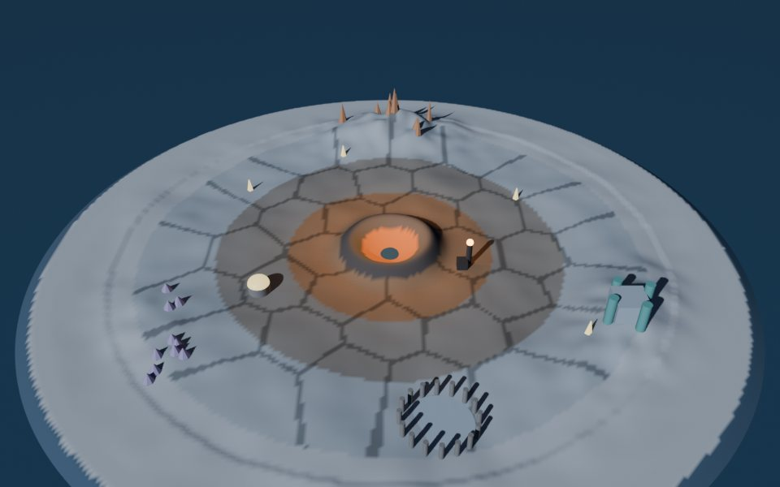

# The game

HALF-LIGHT is a survival game for tribes on a dying world. The sun is XEN's AMP and it cools every day. Territory stays alive only while its people keep it warm. Every season ends in **the Reaping**, a Hunger Games arena where each tribe sends tributes and the whole community sponsors them. Underneath, every warm hex, every sponsor crate and every rescue is a real protocol action.

## The premise

The world is a ring of 37 hexes around **the Hearth**, the great fire at the centre, fed by the Granary. Three tribes hold home sectors: **Embers**, **Wardens** and **Drifters**. **Outlaws** belong to no tribe. The outer rings are rich but freeze first; the inner rings are safe but contested. A hex nobody keeps warm for 3 turns turns to ice.

## Your first ten minutes

1. **Connect your wallet.** The game reads your first XEN rank and names your era: "Genesis-born, rank 41,207" or "Second Wave, rank 18.2M". Your XENFT class gives your caste: scout, smith, envoy or keeper.
2. **Look at the sky.** Every live XEN mint is a star. Yours glow; any that matured unclaimed are dimming. The game tells you how much XEN you lose per day if you wait.
3. **Join a tribe**, or stay an Outlaw.
4. **Take your first order.** Assign your power to a hex your tribe must hold tonight. Power comes from your oaths (active mints), your fire (recent burns) and your patience (unbroken stakes and deposits), not from your balance.

## What you are playing for

- **Territory**, which earns your tribe a share of NXN emission every cycle.
- **Titles**: Reaping champion, Patron, Keeper of a ring. Permanent.
- **The shared fire.** Tribes fight over hexes, but all live off one Hearth. In the Long Fire era the size of the world is set by the XEN left in the Granary. If the store runs dry, everyone freezes. Each tribe decides every day how much to spend on beating rivals and how much to put into the common store. That tension is the heart of the game.

## Pages

- [The tribes](tribes.md): roles, incentives, switching, Outlaws
- [Days and seasons](days-and-seasons.md): the daily turn and the 90-day season
- [The map and power](the-map-and-power.md): hexes, heat, scoring
- [The Reaping](the-reaping.md): tributes and sponsor crates
- [Winning, losing and NXN](winning-and-nxn.md): what NXN does in the game
- [World systems](systems.md): lineage, dying stars, temples, the Core
- [The three eras](eras.md): Creation, Twilight, Long Fire
- [The world and its art](world-and-art.md): the 3D layer and art direction
- [The living world](living-world.md): items, stores and content anyone can add
- [Realms](realms.md): one realm per chain, each with its own sun
- [Anti-exploit](anti-exploit.md): sybils, whales, bots
