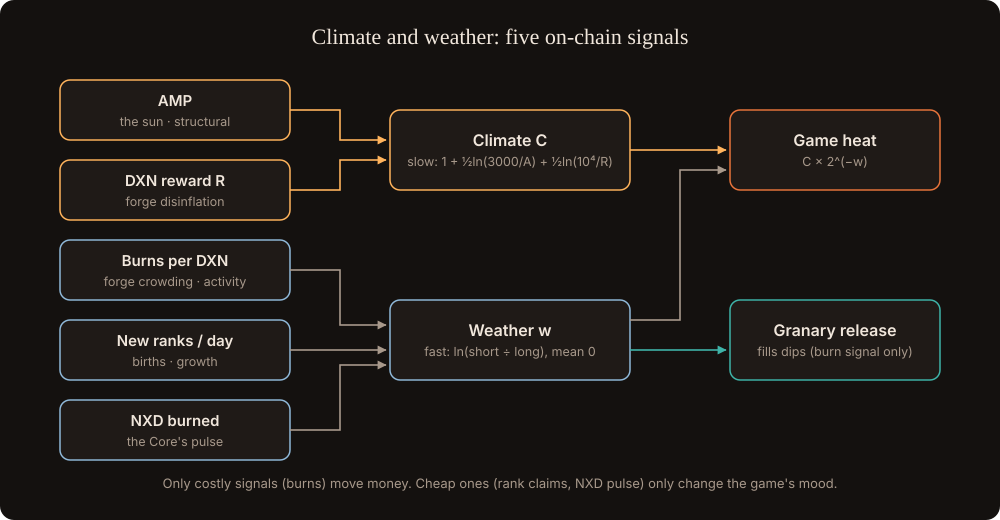

# Climate and weather

The world's cold is not AMP alone. It has a slow **climate**, set by the protocols' structural decline, and a fast **weather**, set by how active the ecosystem is right now. Both are read on chain and both are scale-free: they compare the system with its own past, so they work on any chain, at any price, in any gas regime.

## Signals

| Signal | Read from | Meaning |
| --- | --- | --- |
| AMP | XEN | The sun: structural decline of minting |
| DXN reward per cycle R | DBXen | The forge: DBXen's disinflation |
| Burns per DXN emitted (B / R) | DBXen | How crowded the forge is relative to its reward |
| New ranks per day | XEN global rank | Births: network growth (it also makes waiting minters' log2(Δ) grow) |
| NXD burned per cycle | NXD `HandleRewards` | The Core's pulse |

## Climate (slow)

**C = 1 + ½ · ln(3000 / AMP) + ½ · ln(10,000 / R)**

- About 2.5 today, 7–8 at the AMP floor.
- **No regime switch.** When AMP stops falling in 2030, the forge term keeps cooling the world, but only on cycles where someone burns. If DBXen goes idle, the world stops cooling too, exactly like DBXen's emission.

## Weather (fast)

For each activity signal, compare a short and a long running average (7 and 180 cycles):

**w = clip(½ · ln(S/L) of burns per DXN + ¼ · ln(S/L) of births + ¼ · ln(S/L) of NXD burned, −1, +1)**

- **Averages zero over time.** Weather can't make the game permanently harder or easier; only climate does.
- **Burns are measured per DXN emitted.** Raw burn counts fall every year as DXN disinflates, so they read as winter about 70% of the time (mean w ≈ −0.35 in tests). Burns per DXN, which is what a burner actually sees, bring the mean back to about zero.
- **Winter is simply w < 0**: a bear market, a quiet month and the post-floor drought all register the same way.

## Heat

**Heat = C × 2^(−w)**: the climate sets the baseline; the weather makes the map up to 2× harder in a blizzard and 2× easier in a thaw. Hex thresholds use it: θ = θ₀ × (1 + ring) × Heat.

| Weather | w | Effects |
| --- | --- | --- |
| Thaw | > +0.3 | Expansion is cheap; births are high, so more new stars and stronger Drifters |
| Fair | −0.3 to +0.3 | Normal |
| Frost | < −0.3 | Thresholds rise; **war-burns count ×(1 + abs(w)) for territory**; the Hearth visibly breathes as the Granary releases |
| Blizzard | < −0.7 | The outer ring freezes faster; rescues and deposits are worth more prestige |

The game rewards burning in winter, exactly when DBXen needs it, and the Granary does the same automatically. Both lean against the cycle together.

## In the world

- **The forge glows** with R, and every war-burn shows the DXN it pays.
- **Births** appear as new stars in the sky; Drifter power follows them.
- **The Core pulses** with NXD burns; Council events trigger on a strong pulse.

## Costly signals move money, cheap ones only mood

Rank claims cost only gas and could be spammed to make the weather look warmer. So **the Granary reads only market burns**, which cost real XEN and fees. Births and the NXD pulse only change the game's mood, never money flows.
