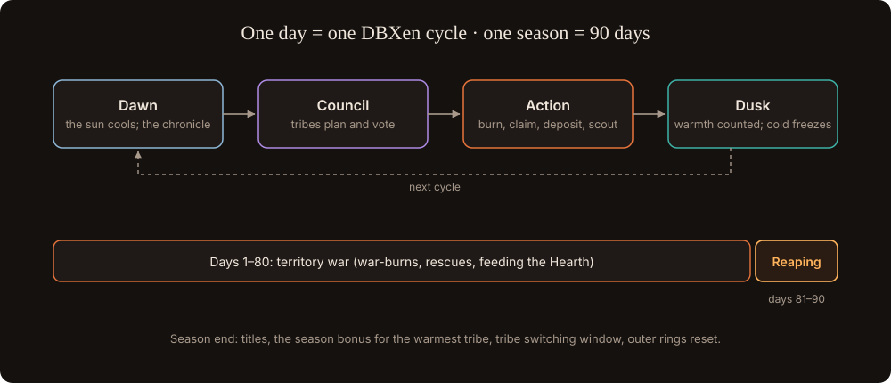

# Days and seasons

The game runs on XEN's own clock.

## One day = one turn = one DBXen cycle

1. **Dawn.** The indexer settles yesterday's chain events: mints, claims, burns per temple, stakes started or broken, Granary deposits. The sun cools by one degree and the weather is read (thaw, fair, frost or blizzard). The chronicle reports which hexes froze, which changed hands, whose stars were rescued, and how full the Granary is.
2. **Council.** Tribe officers propose moves: hold the river hex in ring 2, raid the Wardens' outer flank, call a war-burn for cycle N+2, hire Outlaws. Members vote in the tribe channel.
3. **Action.** You act from your own wallet: claim a matured mint, burn in DBXen on the war-burn day, deposit to the Granary, or spend NXN as emergency fuel. Free actions: scouting, alerts, diplomacy.
4. **Dusk.** Warmth is summed per hex. Contested hexes go to the warmer tribe. Cold hexes lose a turn of life; after 3 cold dusks a hex freezes.

## One season = 90 days = one XEN APY step

- **Days 1–80:** the territory war.
- **Days 81–90:** [the Reaping](the-reaping.md).
- **Season end:** titles awarded, the season bonus for the warmest tribe, the tribe switching window, a reset of the outer rings only. Lineage, birth rank, tribe history and honours persist forever.

## Key dates

| Event | XEN day | Date (approx.) | In the game |
| --- | --- | --- | --- |
| Today | 1,472 | 19 Oct 2026 | AMP ≈ 1,530, APY 4% |
| AMP crosses 1,500 | 1,500 | 16 Nov 2026 | The Half-Light: pre-season |
| APY 4% → 3% | 1,530 | 16 Dec 2026 | Season 1 can begin |
| APY 3% → 2% floor | 1,620 | 16 Mar 2027 | Earliest NXN launch |
| Every 90 days after | 1,710, 1,800… | Jun 2027 onward | Seasons on the same cadence |
| AMP reaches 1 | ~2,999 | ~24 Dec 2030 | The Last Light: Twilight begins, Granary opens |
| Last AMP > 1 mints mature | ~3,470 | ~Apr 2032 | The Long Fire begins |

Dates assume genesis on 8 October 2022 and a decrement of 1 per day; both are to be confirmed against the deployed contract.
