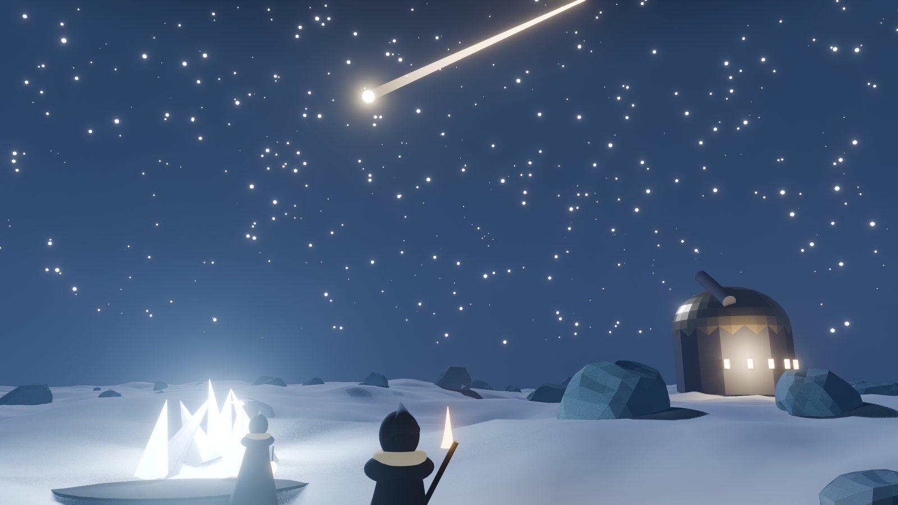

# World systems

Eight systems, each driven by one protocol rule. The first three are the minimum playable game; the rest layer in by season.

| # | System | Protocol rule |
| --- | --- | --- |
| 1 | The Cooling (map) | XEN AMP |
| 2 | Lineage and castes | cRank and XENFT |
| 3 | The Forge and war-burns | DBXen cycles |
| 4 | The Reaping and sponsors | Any temple burn |
| 5 | Dying stars | XEN late-claim penalty |
| 6 | Temples | The burner ecosystem |
| 7 | The Core and the Fallen | NXD and Fenix |
| 8 | The Granary and the Hearth | NXN protocol |

## 1. The Cooling

Concentric rings of hexes around the Hearth. The habitable map shrinks with the heat index, a battle-royale circle driven by a real on-chain clock. See [The map and power](the-map-and-power.md).

## 2. Lineage and castes

- **Era** from a wallet's first rank: Genesis (first 100k ranks), First Wave, Second Wave, Late Born. Eras give heraldry and one small perk, never raw power.
- **Caste** from the best XENFT class held, snapshotted at join: scout, smith, envoy, keeper.
- Lineage is permanent and cannot be bought: the identity layer money cannot fake.

## 3. The Forge and war-burns

Each DBXen cycle is a public arena showing each tribe's share of that day's burns. War-burns are declared on named cycles; members keep 100% of their DXN.

## 4. The Reaping and sponsors

Once a season. See [The Reaping](the-reaping.md).

## 5. Dying stars

The night sky renders every live XEN mint as a star, sized by term and placed by rank. At maturity a star turns gold; each day unclaimed it dims along the penalty curve. Tribes earn prestige when a star they flagged is claimed before heavy penalty. The game makes holders measurably richer by reducing forfeited rewards.

## 6. Temples

Any burner contract that calls XEN `burn()` can be registered as a temple, with a profile: chain, address, what it mints, lore name. Temples sit on the map; pilgrimage quests send players to temples they have never used. Burner projects gain a discovery channel.

## 7. The Core and the Fallen

- **The Core (NXD):** the central zone. Council seats go to season winners. NXD holding unlocks Council cosmetics and a vote on next season's map modifiers. Trading is never rewarded.
- **The Fallen (Fenix):** a Fenix stake held to term earns a survivor mark; the chronicle remembers the stakes that ended early and fed the survivors.

## 8. The Granary and the Hearth

The Hearth at the centre shows the real Granary store. Deposits count toward tribe prestige. In the Long Fire the habitable radius follows the store. Tribe treasuries hold NXN for fuel, crates, war-burn calls and bounties.

## The new-matter indicator

The game shows the current XEN production cost (gas ÷ expected reward per mint) against the market price. When price is above it, the sky marks new stars as worth forging. Players learn how XEN works by playing.
