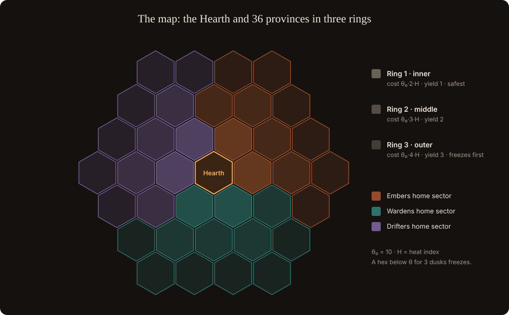

# The map and power

## The map

- **37 hexes:** the Hearth plus 36 provinces in three rings.
- **Warmth threshold** of a hex: **θ = θ₀ × (1 + ring) × Heat**, with θ₀ = 10.
- **Yield** per hex: 1 in the inner ring, 2 in the middle, 3 in the outer ring. Outer hexes pay more and cost more to hold.
- A hex below θ for **3 consecutive dusks** freezes and becomes neutral wasteland.

## Heat: climate and weather

**Heat = C × 2^(−w)**. The climate C = 1 + ½·ln(3000 / AMP) + ½·ln(10,000 / R) follows AMP and DXN disinflation (about 2.5 today, 7–8 at the floor); the weather w follows current activity and makes the map up to 2× harder in a blizzard or easier in a thaw. See [Climate and weather](climate-and-weather.md).

After the floor the climate keeps cooling through DXN disinflation, only on cycles with burns. In the Long Fire, the **habitable radius** is set by the Granary store relative to its size at the floor: the world is as big as its stores.

## Player power

**P = g × min(10, a·ln(1 + T) + b·√B + c·ln(1 + S))**, with a = 1, b = 2, c = 1

| Term | Meaning |
| --- | --- |
| T (oaths) | Remaining committed term days across active XEN mints and XENFTs, each weighted by the AMP it locked. After the floor: term committed and gas spent. |
| B (fire) | XEN burned through registered temples in the last 7 days, in DBXen batches |
| S (patience) | Unbroken stake-days across XEN, DXN and Fenix stakes, plus the glow of Granary deposits (halving every 30 days) |
| g (gate) | 1 if the wallet's first rank is at least 30 days old and it passed anti-bot checks, else 0 |

Power comes from time and breadth of participation. Size is always dampened and capped.

## Hex warmth

**W = Σ P (members assigned to the hex) + F**

- Plain sum. A quadratic sum was rejected: splitting one wallet into k gave k² power.
- F = emergency fuel: 2 warmth per NXN burned on the hex, at most 30% of θ.
- Tribe modifiers: Wardens 2× defending, 0.5× attacking; hired Outlaws 80%; new members 50% for 14 days.
- With the cap and dampening, the top 10% of wallets held **12% of warmth against 74% of capital** in the scoring check.

## War-burns

A tribe declares a war-burn on a named future DBXen cycle (5 NXN from its treasury, one open declaration per tribe). Members burn from their own wallets and keep their DXN. The war-burn score is the sum of √batches per wallet, with any single wallet capped at 25% of its tribe's score. The highest score takes the contested hex. Rival war-burns on the same cycle dilute each other's DXN: the real economic tension is the game.

## Rescues

Rescue prestige per claimed star = the share of reward saved versus the penalty on the day the alert went out, × log(1 + term). Paid once per star, only for stars flagged by a third party, capped per tribe per day.
