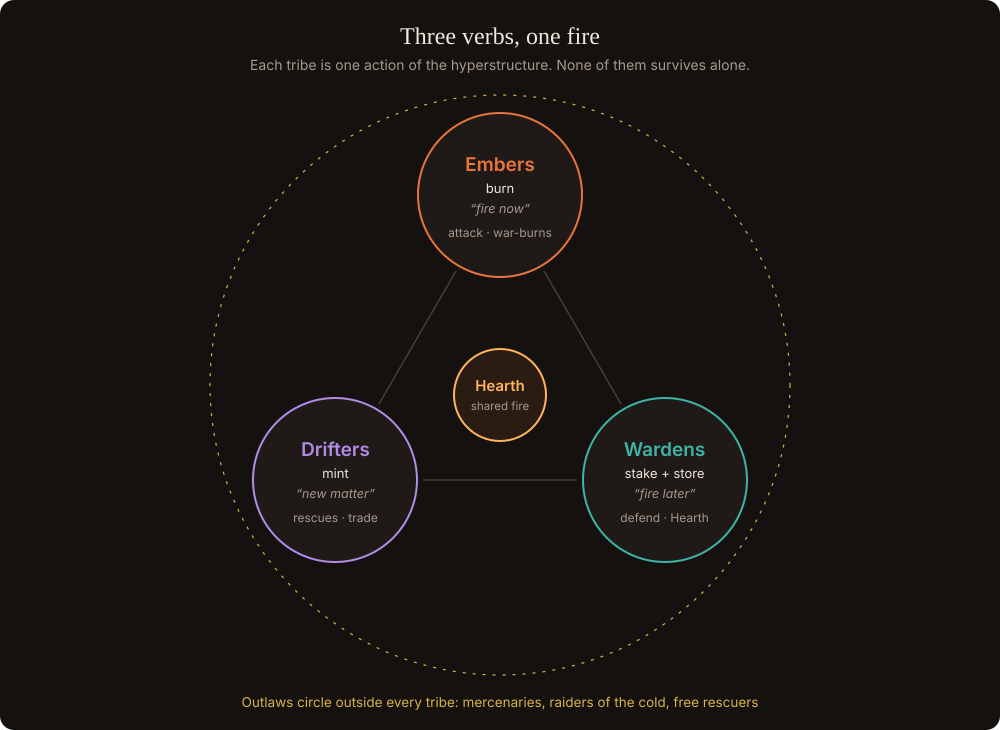

# The tribes

## Three verbs, one fire

The hyperstructure has three verbs: **mint**, **burn**, **stake**. Each tribe is one verb, and none of them survives alone:

- burners without minters run out of fuel;
- stakers without burners keep a store nobody uses;
- minters without burners just add supply.

Tribes fight over territory, but all of them live off one shared fire. The **Outlaws** are the market between them.

## Embers: the burners

| | |
| --- | --- |
| Role | Attackers. They call war-burns on named DBXen cycles, take hexes and keep the front line warm. |
| Power leans on | Recent burns |
| Incentive | Members burn from their own wallets and keep 100% of their DXN. Playing is burning together. |
| Philosophy | "Fire now." They bring DBXen volume from day one, not only after 2031. |
| Limit | Expensive to sustain; their hexes cool fast when they stop. |

## Wardens: the keepers

| | |
| --- | --- |
| Role | Defenders. They hold the inner ring, feed the Granary and keep long stakes unbroken. |
| Power leans on | Stake time and Granary deposits |
| Incentive | The depositor share of NXN emission. |
| Philosophy | "Fire later." They are the new player the hyperstructure was missing: someone who keeps XEN for the burns needed after AMP reaches 1. |
| Limit | Defensive by nature; their power fades unless they keep depositing. |

**Why Wardens need limits.** In the season simulator, the tribe that fed the Hearth won 5 of 6 seasons, and every deposit moves some burns from today to later. Draft balance rules:

- **Glow fades.** A deposit stays in the Granary forever, but its game power halves every **30 days**. To hold the Hearth, you keep depositing.
- **Defensive by nature.** Warden warmth counts **2×** when defending their own hexes and **0.5×** when attacking.
- **Burner bonus.** 1.25× deposit weight for wallets that also burned in DBXen that cycle.
- **Half-burn deposits.** Each deposit burns 50% through DBXen at once (see [Deposits and emission](../granary/deposits-and-emission.md)).

## Drifters: the minters and rescuers

| | |
| --- | --- |
| Role | Scouts and traders. They read the sky of live mints, rescue matured mints before the late-claim penalty, collect rescue tithes and run sponsor crates. |
| Power leans on | Committed mint terms |
| Incentive | Prestige and NXN from rescues; they are the best recruiters of new players. |
| Philosophy | "Keep new matter coming." |
| Limit | Their AMP-weighted power fades toward the floor. |

**After the floor**, XEN still mints, only smaller, whenever price beats gas. Drifter power then counts **term committed and gas spent** instead of AMP, and Drifters become the floor miners: the people who still create new XEN. They are also the caravan guides and traders between tribes.

## Outlaws: the ones who refuse the oath

The free agents: traders, mercenaries, people who won't commit to one tribe. Without a role they would just leave. Outlaws are useful but never the strongest choice.

- **No territory.** Outlaws cannot hold hexes and get no share of the Hearth.
- **Mercenaries.** A tribe can hire Outlaws for a war-burn. The Outlaw burns from their own wallet and keeps the DXN; their power counts for the hiring tribe at **80%**. The tribe pays an NXN bounty, 10% of it burned.
- **Raiders of the cold.** Outlaws can claim hexes that fall below their warmth threshold. This punishes overextended tribes and balances the Wardens. Raids change game state only; no real asset is ever taken.
- **Free rescuers.** They can rescue any mint for anyone, competing with Drifters on speed.
- **Wildcard tribute.** One Outlaw tribute per Reaping, picked by block hash.
- **Way back in.** An Outlaw can join a tribe at season end through the normal oath. A tribe can exile a member to Outlaw status by vote.

80% power, no Hearth share and no territory mean pure Outlaw play pays only while the tribes are fighting each other.

## Joining and switching

- New players choose a tribe. Smaller tribes get a recruit bonus so the three stay balanced.
- Switching is allowed **only between seasons**, after the Reaping. No desertion mid-season.
- **Oath period:** a new member's power counts at **50% for 14 days**, so nobody can hop to the winning tribe for the Reaping.
- Titles are permanent; tribe-bound prestige stays with the old tribe.
- Why allow switching at all: a tribe can collapse late in the game. Without switching those players quit; with it, the world rebalances.

## Balance targets

Over many simulated seasons:

1. each tribe wins roughly a third of the time;
2. pure Outlaw play is never the best strategy;
3. the winning tribe earns about 2–3× the NXN of the last tribe, without one tribe winning every season.

All values marked here (30 days, 2× / 0.5×, 80%, 50% for 14 days) are starting points to tune.
