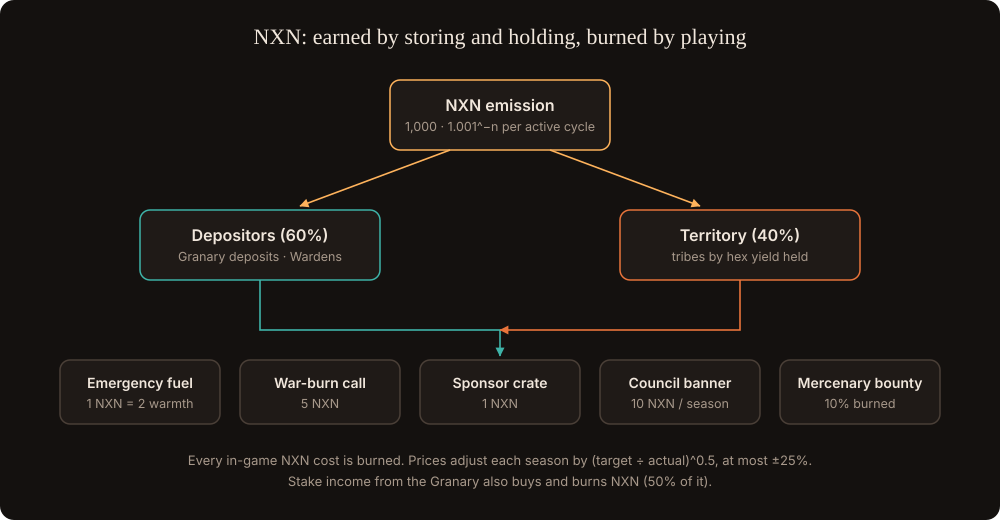

# Winning, losing and NXN

NXN is **never needed to play**: power comes from participation. NXN is fuel and coordination, and it is the exchange rate between "fire later" (storing) and "fire now" (attacking). **Every NXN spent in the game is burned.**

## Who earns and who spends

| Who | Earns NXN from | Spends NXN on |
| --- | --- | --- |
| Wardens | Depositor share of emission | Emergency fuel to defend |
| Embers | Territory share | War-burn declarations, fuel |
| Drifters | Territory share, rescue bounties | Sponsor crates |
| Outlaws | Mercenary bounties, rescue bounties | Sponsor crates |
| Tribe treasuries | Members' contributions | Banners, bounties, war-burn calls |

If Wardens grow too strong, attacking gets expensive, demand for NXN rises, and Wardens earn more by selling NXN than by sitting on the centre.

## Prices

| Use | Cost | Limit |
| --- | --- | --- |
| Emergency fuel for a hex | 1 NXN per 2 warmth for one turn | At most 30% of the hex's threshold |
| Sponsor crate | 1 NXN | Crate limits in [The Reaping](the-reaping.md) |
| War-burn declaration | 5 NXN from the tribe treasury | One open declaration per tribe |
| Rescue bounty | Set by the tribe | Paid only when the star is claimed |
| Hearth Council banner | 10 NXN per season | Season winners only |
| Mercenary bounty | Set by the hiring tribe | 10% burned |

**Price rule.** Target: players burn on average 0.05 NXN per active player per day × H. At each season start, every price is multiplied by **(target ÷ actual)^0.5**, at most ±25%. The rule is published and applied by formula, not by an operator.

**Rescue tithe.** When a rescued star is claimed, the owner is offered a one-click deposit of 10% of the reward into the Granary. They receive NXN for it; the rescuing tribe gets the prestige.

## Winning and losing

- **Territory earns NXN.** 40% of each cycle's NXN emission goes to tribes in proportion to the yield of the hexes they hold at dusk, then to members by power contributed that cycle.
- **Losing costs income.** Lose a hex, lose its stream. A frozen hex pays nobody.
- **Season bonus.** The tribe holding the most yield at season end gets **1.5× territory share for the first 30 days** of the next season. Winning carries forward, but fades.
- **No new inflation.** This redirects existing emission; total NXN supply is unchanged.
- **Status.** Permanent titles: Reaping champion, Patron, Keeper of a ring.
- **Target.** The winning tribe earns roughly 2–3× the last tribe, without one tribe winning every season.

## What the game never does: losers paying winners

A pot funded by losers' spending would make the game wagering, a legal risk in many countries, and it drives out the players who lose. The rule is: every cost is a burn, players keep their DXN, and winners earn more of emission that already exists. The legal review still needs to confirm this.
