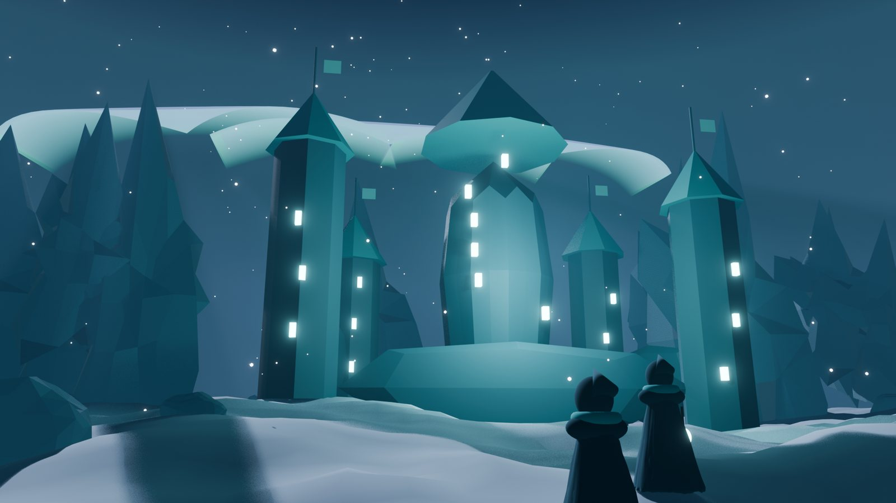
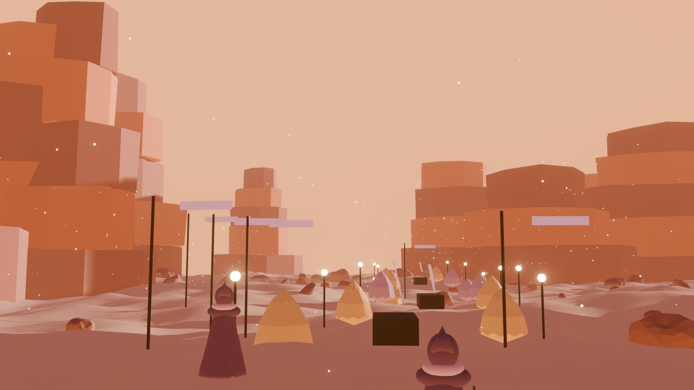

# The world and its art

## Two layers

| Layer | What it is | Why |
| --- | --- | --- |
| **The war table (2D)** | The hex map, orders, warmth, the chronicle | The real game state: small, open, deterministic, cheap to build and verify |
| **The world (3D)** | A third-person world: the Hearth, the homelands, the coliseum, the Granary | Presence and spectacle: walking to the Hearth, watching the Reaping, meeting your tribe |

The 3D world never decides anything. Everything that counts happens on the war table, which anyone can recompute from chain events. That lets the world grow with whatever tools come next, including AI characters (always declared, never holding power) and contributor-built regions, without risking the rules.

## Places

- **The Hearth and the Granary** at the centre: silos of stored XEN around a lava pool and a pillar of fire, with DXN and NXD vaults by the gate.
- **The Ember Ring:** forges and burning towers on black rock.
- **The Wardens' Keep:** walls and long-banked fires in the cold.
- **The Drifters' caravan:** wagons and lanterns crossing the ice.
- **The Reaping coliseum:** a frozen arena under a dimming sun.
- **Starfall:** the sky of live mints, gold when mature, dimming when late.

## Art direction

| | |
| --- | --- |
| Mood | A dying sun: warm fire against blue cold |
| Palette | Embers `#e8743b` · Wardens `#3eb3a8` · Drifters `#b08ce6` · Outlaws `#d9b44a` · Hearth `#ffb35c` · night `#14110f` |
| Light | Firelight is the only warm light; everything far from fire is blue and quiet |
| Shapes | Simple, readable silhouettes that work at thumbnail size |
| Text | Serif for lore and titles, clean sans for numbers and rules |

All scenes were made procedurally in Blender so they can be regenerated, extended and remixed. The source files are kept outside this repository for now.

## Technical direction

- Engine-agnostic content: regions, lore and items as data files.
- A browser-first 3D client (three.js) built on the same assets.
- Open source rules engine, so the world can be rebuilt by anyone.
