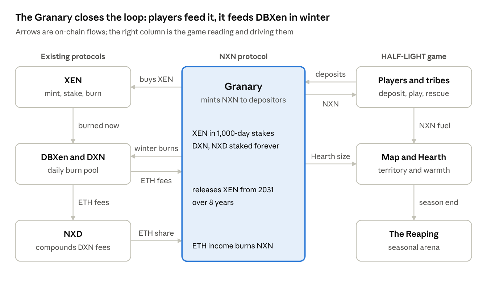

# The NXN protocol

**NXN is the closure token of the stack.** XEN rewards minting, DXN rewards burning now, NXD compounds DBXen fees, and NXN rewards **storing XEN to burn after AMP reaches 1**. Its contract is the **Granary**; in the game it is the **Hearth**.

## In one paragraph

People deposit XEN (and optionally DXN or NXD) into the Granary. Deposits are never withdrawable. The Granary stakes the XEN for 1,000-day terms and keeps the stake rewards. Depositors earn NXN each cycle. Whenever DBXen goes cold (in any bear market, and every day after the AMP floor) the Granary burns part of its store into DBXen. Callers pay the DBXen fee through the Hearth-lighting auction and keep part of the DXN; a small reserve covers what the market won't. The ETH income from its DXN and NXD stakes buys and burns NXN and refills the store.

## Contracts

| Contract | Job | Admin |
| --- | --- | --- |
| NXN (ERC-20) | Minted only by the Granary; burnable by holders | None |
| Granary | Takes deposits, mints NXN, runs vaults, releases XEN to DBXen, routes ETH | None, not upgradeable |
| XenVault clones | One XEN stake each (XEN allows one stake per address); 1,000-day terms, staggered | Granary only |
| Reserve (escrow) | Small ETH reserve that pays fees for release lots the auction leaves unsold | Granary only |
| Tribe registry | Wallets declare their tribe (changes only between seasons), so the Granary can credit the Keeper tribe without an oracle | None |

No premine, no team allocation, no admin keys.

## Parameters at a glance

| Rule | Draft position |
| --- | --- |
| Emission | $1{,}000 \times 1.001^{-n}$ NXN per active cycle; max supply ≈ 1,001,000 |
| Emission split | 60% to depositors, 40% to game territory holders |
| Deposits | XEN in 2.5M batches (plus an energy fee); DXN and NXD in any amount; never withdrawable |
| Half-burn deposits | Each XEN deposit burns 50% through DBXen at once and stores 50% (to simulate) |
| Pool weights | XEN $= 0.5 + 0.4 \times \text{AMP} / 3000$; DXN = ⅔ of the rest; NXD = ⅓ of the rest |
| Burner bonus | 1.25× deposit weight for wallets that also burned in DBXen that cycle |
| DXN and NXD share | No hard cap; rewards taper as the Granary's share of staked DXN or NXD grows (hard 10% cap as the alternative) |
| Energy fee | DBXen's fee formula; funds the small reserve; surplus buys XEN for the store |
| Income routing | 50% buys and burns NXN, 30% buys XEN, 20% buys DXN |
| Release | Any era: ½ × the activity gap (before the floor only from yield); after the floor plus store ÷ days to an 8-year horizon. Executed by the Hearth-lighting auction, then the reserve; only on active cycles |
| Launch | Earliest 16 March 2027, only if the [launch gates](launch-gates.md) pass |

## Pages

- [Deposits and emission](deposits-and-emission.md)
- [Storage and routing](storage-and-routing.md)
- [Release](release.md)
- [Lighting the Hearth](lighting-the-hearth.md)
- [Launch gates](launch-gates.md)
