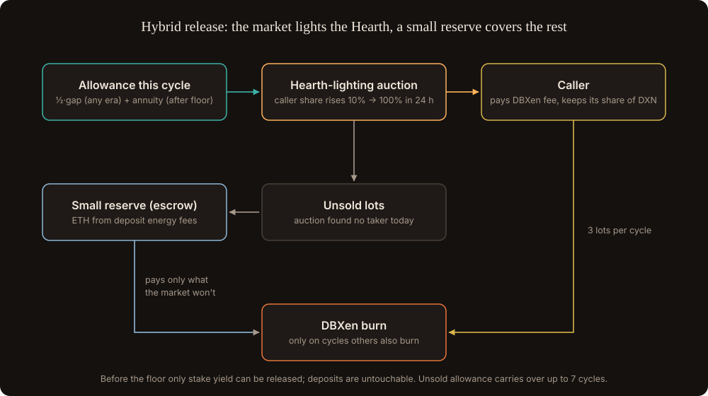

# Release

The Granary releases stored XEN into DBXen whenever DBXen goes cold, not only after AMP reaches 1. A bear market is a winter too; the floor in December 2030 is just the one winter whose date we know.

## Two winters, one rule

| Winter | Cause | When |
| --- | --- | --- |
| Cyclical | Bear markets, quiet months | Any time |
| Structural | AMP reaches 1, DXN emission small | From ~24 Dec 2030 |

Each cycle the Granary opens an **allowance** of batches:

**allowance = ½ × gap + annuity**

| Part | Rule | When |
| --- | --- | --- |
| Gap | gap = max(0, L − S) on market activity, measured as burns per DXN emitted (see [Climate and weather](../game/climate-and-weather.md)); S = 7-cycle average, L = 180-cycle average; converted back to batches | Any era |
| Annuity | store ÷ days left until the horizon (8 years after the floor), with a 90-day ramp | After the floor |

Limits:

- **Before the floor, only the yield can be released** (2% stake rewards plus XEN bought with income). Deposits are untouchable, so a bad 2027 can't drain the reserve for 2031.
- **After the floor**, the cyclical part is capped at 3 × the annuity.
- **Only on active cycles.** No release on a cycle with zero market burns, so DBXen's natural pause on quiet cycles stays intact.
- Unsold allowance carries over for up to 7 cycles.

## Who pays: the hybrid

1. **The Hearth-lighting auction first.** Anyone can burn the allowance by paying the DBXen fee from their own wallet. The share of DXN they keep starts at 10% and rises to 100% over the cycle; the first caller takes it. The allowance is sold in 3 lots. See [Lighting the Hearth](lighting-the-hearth.md).
2. **A small reserve for the rest.** Lots nobody takes are burned by the Granary itself, paying the fee from a small ETH reserve funded by deposit energy fees. The reserve only pays what the market won't, so it lasts far longer than an escrow that pays for everything.

Nobody has to guess future gas: when gas is high, callers simply wait for a higher share, and the reserve covers what is left while it can.

## Why this rule

| Property | Why it holds |
| --- | --- |
| Can't oscillate | It reacts to market burns only, never its own, so there is no feedback loop to tune |
| Can't overshoot | Filling half the gap corrects at most half of any misread |
| Self-correcting drawdown | Store ÷ days left is the classic optimal rule for spending a fixed stock evenly. Extra release in a winter means slightly less on every later day, and the store still lasts to the horizon |
| Reserve stays intact before the floor | Only yield is spent |
| Independent of ε | It works however strongly burns react to emission |
| No price oracle | It reads batch counts and the store; the auction discovers gas and DXN prices |

## What the synthetic test showed

120 synthetic worlds with bull and bear cycles, gas regimes and DXN disinflation, run to 2040 (see [Simulations](../model/simulations.md)):

| Setup | Post-floor burns vs no Granary | Worst 90 days | DXN the Granary keeps | Store left unspent at horizon | Speeds DXN decay |
| --- | --- | --- | --- | --- | --- |
| Fixed rule, escrow sized at deposit-time gas | +41% | ~9× | 100% | in 35% of runs (escrow ran dry) | Yes |
| Auction only, fee is most of a burn's cost | +8% | 1× | 26% | in ~100% of runs | No |
| Auction only, XEN is most of a burn's cost | +28% | ~1× | 65% | in 82% of runs | No |
| **Hybrid** | **+57%** | **~9–10×** | **~70%** | **in 6–17% of runs** | **No** |

**Lesson:** the Granary's XEN is free to a caller, but the ETH fee is not. The auction alone works only when XEN is a large share of what a burn costs. The hybrid works in both cases.

Deposits were never touched before the floor in any run. Releasing on quiet cycles made results worse, so the active-cycle rule stays.

## Rejected options

- **A 20% cap on release** (no more than 20% of market burns): it made the Granary do nothing.
- **Short horizons (3–5 years):** worst-year flow of 1.3–1.9% of today, far worse than 8 years.
- **A fixed escrow paying every release:** depends on guessing gas years ahead and speeds DXN decay by burning on quiet cycles.

## What happens when the store runs dry

The game's world shrinks with the store (see [The three eras](../game/eras.md)). What the ending looks like is an [open question](../open-questions.md).
