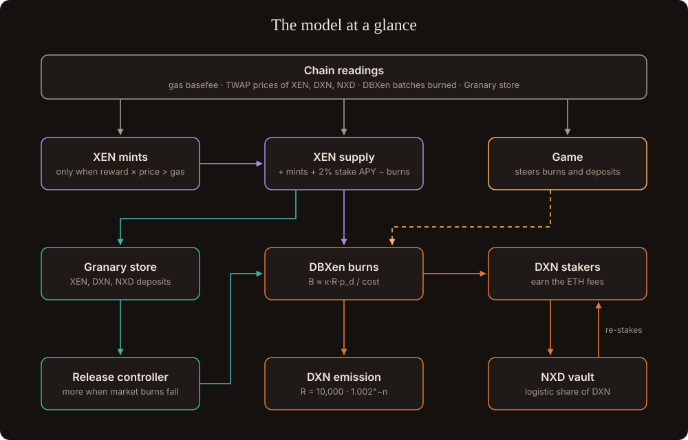

# The model

A simplified analytical model of XEN, DBXen, NXD, the Granary and the game. The equations come from the contracts. The coefficients (κ, ε, η, ρ…) must be fitted from on-chain data before the numbers mean anything; the design parameters are then chosen by simulation.

Time step: one day = one DBXen cycle. Prices are TWAPs in ETH.

## Inputs read from chain

| Input | Symbol | Source |
| --- | --- | --- |
| Gas cost | g | `block.basefee` × gas units of each action |
| XEN, DXN, NXD prices | p_x, p_d, p_n | Uniswap TWAP (30 minutes or longer) |
| DBXen batches per cycle | B | `cycleTotalBatchesBurned` |
| DBXen reward per cycle | R | `rewardPerCycle` |
| XEN global rank, AMP | rank, A | XEN contract |
| Granary store | G | Granary contract |

Controllers use **on-chain quantities** (batches, store, basefee) wherever possible. Prices are used only where unavoidable (game costs), always as TWAPs.

## 1. XEN

- Mint reward: **r = log2(Δ) × A × T × (1 + EAAR)**; at the floor **r ≈ log2(Δ) × T**.
- Break-even price: **p_x\* = c_m / r**, with c_m the gas cost of claimRank + claimMintReward.
- Mints per day: **N_m = N_0 × (p_x r / c_m)^η**, zero below break-even.
- Supply: **dS/dt = N_m·r (lagged by T) + s·S·APY/365 − 2.5M·B − Granary deposits**, with APY = 2% from March 2027 and s the staked share.

This caps supply growth at production cost; it is not a price floor.

## 2. DBXen

- Emission: **R_n = 10,000 × 1.002^−n**.
- Free-entry burns: **B = κ × R × p_d / (2.5M × p_x + c_b)**, with c_b the fee per batch and κ the burn premium (κ > 1 when people burn above the DXN's current value).
- Empirically **B ∝ R^ε**. About 1,500 more active cycles before the floor shrink R by about 20×:

| ε | Post-floor burns vs today |
| --- | --- |
| 0.5 | ~22% |
| 0.7 | ~12% |
| 1.0 | ~5% |

- DXN staker yield: y = F / (staked DXN × p_d), F = fees per cycle.

## 3. NXD

NXD's share φ of staked DXN is logistic: **dφ/dt = y × ρ_N × φ × (1 − φ)**. Doubling time while small ≈ ln 2 / (y·ρ_N).

## 4. Granary

- Store: **dG/dt = deposits − release**.
- Deposits follow the same free-entry logic as burns: **D = κ_G × (NXN to depositors) × p_n / (2.5M × p_x + c_e)**.
- DXN share: **dφ_G/dt = d_G / D_total + y × 0.2 × φ_G × (1 − φ)**. Its compounding is weak, so its share grows through deposits.
- Release: **Rel = (G / τ) × clip((B\* / B̄)^γ, m_lo, m_hi)**. See [Release](../granary/release.md).

## 5. Game

- Heat: H = 1 + ln(3000 / A) before the floor; H = 9 × S(floor) / S(t) after it.
- Extra burns and deposits from the game: **ΔB = λ × active players**, λ fitted from the prototype.
- NXN prices adjust ×(target / actual)^0.5, at most ±25% per season.

## Coefficients to fit

| Symbol | Meaning | How to estimate | Data |
| --- | --- | --- | --- |
| κ, ε | Burn premium and elasticity | Regress log B on log R, p_d, p_x, c_b | DBXen events, Uniswap, gas |
| c_b | Fee per batch | Transaction receipts | DBXen burns |
| N_0, η | Mint level and response | Claims per day vs p_x·r / c_m | XEN RankClaimed and MintClaimed events |
| T̄, Δ | Average term, rank growth | Event history | XEN events |
| y, F | DXN fee yield, fees per cycle | Fees ÷ staked DXN | DBXen |
| ρ_N | NXD re-stake share | Contract code + reward transactions | NXD |
| s | Staked XEN share | Contract reads | XEN |
| κ_G | Depositor premium | Unknown before launch; prior = κ | — |
| λ | Burns per active player | Prototype telemetry | Game |

**Design parameters chosen by simulation:** τ, γ, m_lo, m_hi, B\*, the emission split, the deposit taper.
