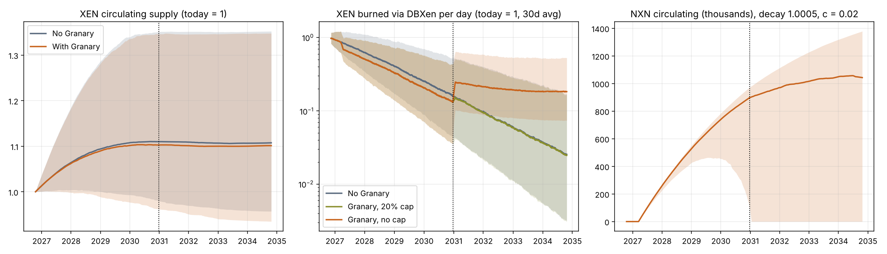
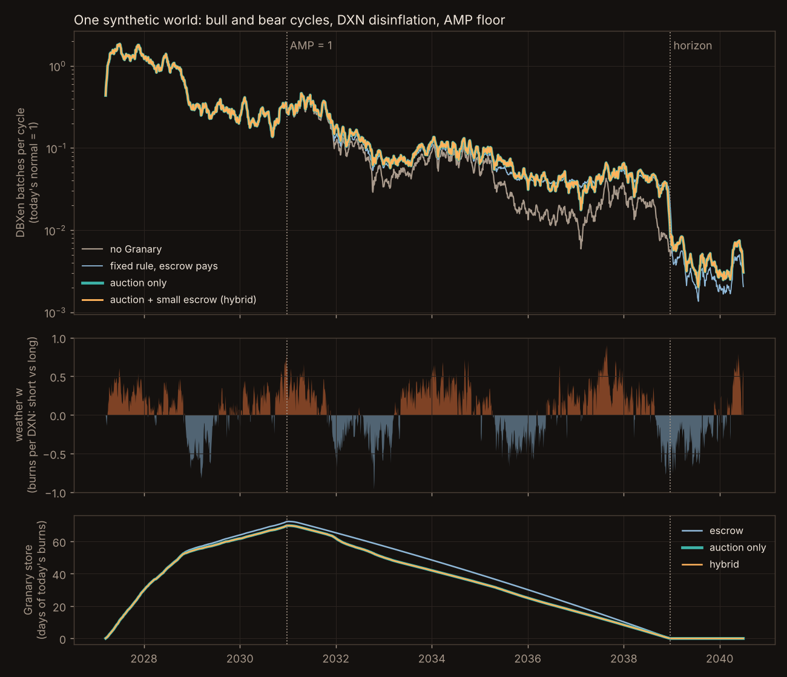

# Simulations

A Monte Carlo of XEN, DBXen and the Granary: 1,000–2,000 runs, daily steps from October 2026 to 2034–2037. XEN amounts are in units of today's circulating supply, so no live supply figure is needed. Contract rules come from the verified source; **every market input is a guessed range until measured on chain**. Treat results as directions, not forecasts.

The code is in the `sim/` folder at the root of the repository. Change the ranges in `draw_priors()` and post what you find.

## Guessed inputs

| Input | Range |
| --- | --- |
| Current XEN mint inflation | 3–25% per year |
| Current burn rate | 0.5–10% of supply per year |
| Burn response to DXN reward decay (ε) | 0.3–1.0 |
| Break-even AMP at today's price and gas | 30–1,500 |
| DBXen active cycles so far | 1,000–1,290 |
| Share of XEN staked | 2–15% |
| Granary deposits diverted from DBXen / new demand | 5–30% / 0–30% |

## Results (medians)

| Question | Result |
| --- | --- |
| DXN reward per cycle | ~1,000 today; about 5% of that by the floor |
| DBXen burn flow after the floor, no Granary | ~5–7% of today |
| Same, with the Granary (8-year release), no game | ~1.7× the no-Granary case |
| Same, with the Granary and game-driven deposits | ~2.4× the no-Granary case |
| DBXen flow before 2030 with the Granary | ~83% of the no-Granary case |
| Worst-year DBXen flow 2031–2037 | ~11% of today, vs ~1.1% with no Granary |
| Store left in 2037 (8-year release) | ~35% |
| XEN turns net deflationary | median Oct 2029; ~39% of runs never by 2034; the Granary moves it by weeks |
| NXN decay 1.002 vs 1.001 | 1.002 mints 52% in year one; 1.001 peaks supply near the floor |
| 20% cap on release | Makes the Granary do nothing |
| Quadratic tribe scoring | Splitting one wallet into k gave k² power; plain sum chosen |

**What the Granary is:** DBXen's winter reserve, not an XEN supply tool.

**Diversion matters.** With little diversion from DBXen (0–5%), pre-floor flow stayed near 97% of the no-Granary case. With 20–30% diversion it fell to about 74%. The burner bonus and half-burn deposits exist to keep diversion low.

## What drives the results

- Post-floor DBXen flow depends almost only on **ε** (rank correlation −0.70).
- The deflation date depends on today's **burn rate**, the **break-even AMP**, ε and the mint rate.

## Season simulator

The game simulator (`sim/game/half-light-simulator.html`, open it in a browser) plays seasons on the 37-hex map with AI tribes and lets you play as one. First findings: the Hearth-feeding tribe won 5 of 6 seasons (hence the Warden limits), and the Long Fire world at maximum heat is nearly empty.

## Release controller and the Hearth-lighting auction (synthetic test)

`sim/hearth_controller_test.py` tests the [release rule](../granary/release.md) and the [auction](../granary/lighting-the-hearth.md) with **no market data**: 120 synthetic worlds with bull and bear cycles, gas regimes and burn noise, run from March 2027 to 2040. Protocol rules (DXN emission decay, 2% stake yield, the AMP floor date) are exact. Each world is run twice: once where the ETH fee is most of a burn's cost (XEN cheap) and once where XEN is most of it.

| Setup | Post-floor burns vs no Granary | Worst 90 days | DXN the Granary keeps | Store left unspent at horizon | Speeds DXN decay |
| --- | --- | --- | --- | --- | --- |
| Fixed rule, escrow sized at deposit-time gas | +41% | ~9× | 100% | in 35% of runs | Yes |
| Auction only, fee is most of the cost | +8% | 1× | 26% | in ~100% of runs | No |
| Auction only, XEN is most of the cost | +28% | ~1× | 65% | in 82% of runs | No |
| **Hybrid (auction first, small reserve for the rest)** | **+57%** | **~9–10×** | **~70%** | **in 6–17% of runs** | **No** |

Other findings:

- **Deposits were never touched before the floor**, in any run.
- **Tribe prestige** (Keeper of the Hearth) raised the Granary's kept share by about 12 points.
- **A closed tribe cartel** cut the kept share to about 10%; **open access** (Outlaws and bots can light) restored it fully.
- **Releasing on quiet cycles** made results worse, because it speeds DXN decay. The active-cycle rule stays.
- **Weather must use burns per DXN emitted.** Raw burns read as winter about 70% of the time (mean $w \approx -0.35$); burns per DXN give a mean of about zero.

Caveats: synthetic worlds, not forecasts. The fee share of a burn's cost is the biggest unknown, which is why both cases were run. The reserve size (1.2× the fee at deposit-time gas) and the prestige value (10–20% of a lot) are guesses. The game's own extra burns are not included.

## Still to simulate

- Replay past DBXen bear markets with the hybrid rule
- Size of the small reserve and the auction range
- Half-burn deposits
- DXN and NXD deposits: hard 10% cap vs no cap vs taper
- Warden limits, Outlaws, and the 60/40 emission split against the balance targets
- Wallet splitting under the per-wallet cap

## Limits

Prices are random walks, not modelled from supply and demand. When the NXN sink exceeds supply, the model shows supply at zero instead of a price rise. Earlier runs treated floor minting as almost dead, so they probably underestimate post-floor XEN.
