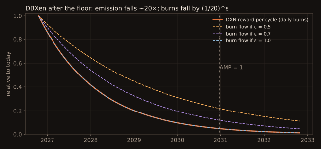

# DBXen

DBXen turns XEN burns into DXN.

> **DBXen v2.** The original DBXen was exploited in March 2026 (on BNB Chain, through a mix-up between the ERC-2771 forwarder and the real sender in `burnBatch`). Its developer, Ruan, released **DBXen v2** as the new protocol, and holders of the original were offered a migration whose window has now closed. Some holders could not migrate after the price fell. **HALF-LIGHT and the Granary build on DBXen v2.**
>
> DBXen v2 keeps the same rules as the original, with the exploit removed. The rules below apply to v2.

## Rules

- Burns happen in **batches of 2.5M XEN**, 1 to 10,000 batches per transaction.
- Each burn pays an **ETH fee** ≈ gas used × gas price × batches × (1 − 0.00005 × batches).
- The fee goes to **DXN stakers**.
- Each 24-hour cycle distributes a reward pool to that cycle's burners, pro rata to batches.
- The pool starts at **10,000 DXN** and is divided by **1.002** only on cycles that see a burn. A quiet cycle pauses decay.

**R_n = 10,000 × 1.002^−n**, where n is the number of active cycles so far.

With roughly 1,000–1,300 active cycles so far, today's pool is about **1,000 DXN per cycle**. About 1,500 more active cycles before the AMP floor bring it to about **1/20 of that**.

## Why burns fall with emission

If burners keep burning until the cost of a batch (XEN plus fee) roughly equals the DXN it earns:

**B ≈ κ × R × p_d / (2.5M × p_x + fee)**

Burn volume follows emission. Empirically, burns scale as R^ε, and ε (between about 0.3 and 1) is the single most important unknown in the whole model. See [The model](../model/README.md).

## Useful reads

`getCurrentCycle()`, `cycleTotalBatchesBurned(cycle)`, `rewardPerCycle(cycle)`, events `Burn(userAddress, batchNumber)`, `NewCycleStarted`, `Staked`, `Unstaked`.
