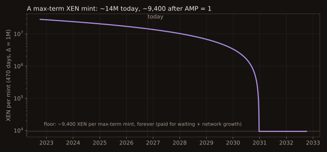

# XEN

## Minting

A wallet calls `claimRank(term)`, waits `term` days, then calls `claimMintReward()`. The reward is:

**r = log2(max(Δ, 2)) × AMP × term × (1000 + EAAR) / 1000**

- **AMP** = max(3000 − days since genesis, 1), locked at claimRank.
- **Δ** = globalRank at claim time − your rank: how many people joined after you while you waited.
- **term** = days committed, up to 100 + 15 × log2(globalRank) (about 465–480 days today).
- **EAAR** = early-adopter bonus, 0 once global rank passes 10M (probably already the case on mainnet).

There is no balance in the formula. XEN pays for **waiting** (term) and for **network growth while you wait** (Δ). Money is created by delayed gratification rather than by debt.

| Moment | AMP | XEN per max-term mint (470 days, Δ = 1M) | DBXen batches |
| --- | --- | --- | --- |
| Genesis | 3,000 | ~28.1M | ~11.2 |
| Today (19 Oct 2026) | ~1,530 | ~14.3M | ~5.7 |
| Half-Light (16 Nov 2026) | 1,500 | ~14.0M | ~5.6 |
| Floor (~24 Dec 2030) | 1 | ~9,400 | ~0.004 |

## Late claims

A matured mint that is not claimed loses part of its reward: 0, 1, 3, 8, 17, 35 and 72% on days 0–6 late, then 99%. In the game these are **dying stars**, and saving them is a **rescue**.

## Staking

Staking burns the XEN and re-mints principal plus reward at withdrawal. APY starts at 20% and falls by 1 point every 90 days to a **2% floor** (reached on 16 March 2027), locked at stake start. One stake per address. Early withdrawal returns principal with no reward.

Steps ahead: 4% → 3% on 16 December 2026, 3% → 2% on 16 March 2027. HALF-LIGHT seasons follow these 90-day steps.

## Burning

`burn(user, amount)` can only be called by contracts that implement `IBurnRedeemable`. Every such contract is a **temple** in the game.

## Break-even

A mint costs gas for two transactions, whatever AMP is. Minting is rational only while:

**p_x × r > c_m** (XEN price × reward > gas cost of both transactions)

This break-even line, the **dawn line**, moves with price and gas and differs by chain. It caps how fast supply can grow, but it is not a price floor: existing XEN can trade below it.
