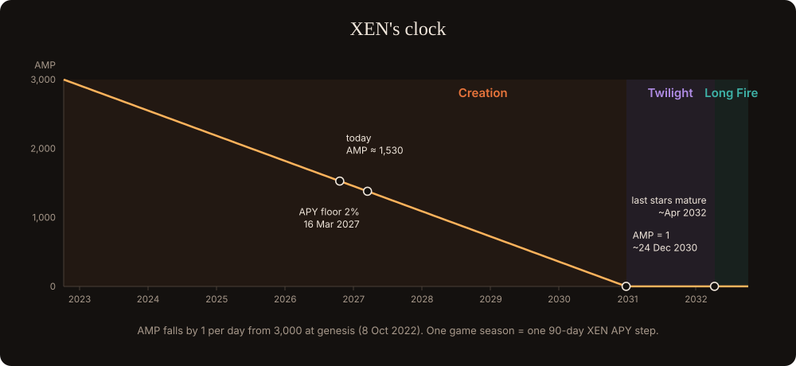

# The winter problem

## The clock

XEN's amplifier (AMP) starts at 3,000 at genesis (8 October 2022) and falls by 1 every day until it reaches 1 on about **24 December 2030**. AMP multiplies every new mint, so the amount of new XEN arriving each day falls with it.

## What happens at the floor

- **Minting pays about 1,500× less than today.** A max-term mint pays about 14 million XEN today and about 9,400 at the floor (see [XEN](protocols/xen.md)).
- **DBXen's emission has also shrunk.** It falls by 0.2% on every cycle with burns. By the floor it is roughly 1/20 of today.
- **Burns depend on XEN that already exists.** Every batch is still 2.5 million XEN, now drawn from a finite stock.
- **NXD follows the burns.** Its income is DBXen fees; fewer burns mean less income.

The stack turns from a **flow economy** (new XEN minted, then burned) into a **stock economy** (an existing XEN reserve burned down).

## The gap

Every layer rewards one verb:

| Layer | Rewards |
| --- | --- |
| XEN | minting (time and network growth) |
| DBXen | burning now |
| NXD | compounding DBXen fees |

Nobody is rewarded for **keeping XEN for the winter**, when DBXen needs burns most and new XEN is scarce. Without that, simulations put DBXen's burn flow after the floor at about **5–7% of today**, with long stretches of near-silent cycles.

## The answer, in two parts

1. **The Granary and NXN.** A contract that takes XEN now, stakes it, and burns it into DBXen after the floor. Depositors earn NXN. This is the closure of the stack. See [The NXN protocol](granary/README.md).
2. **HALF-LIGHT.** The Granary alone mostly moves burns from today to later. A game gives people new reasons to burn and deposit, every day, starting now. See [The game](game/README.md).

In the simulations, the Granary alone raises post-floor DBXen flow to about **1.7×** the no-Granary case, and to about **2.4×** with game-driven deposits. The worst year after the floor goes from about 1% of today's flow to about 11%. See [Simulations](model/simulations.md).
